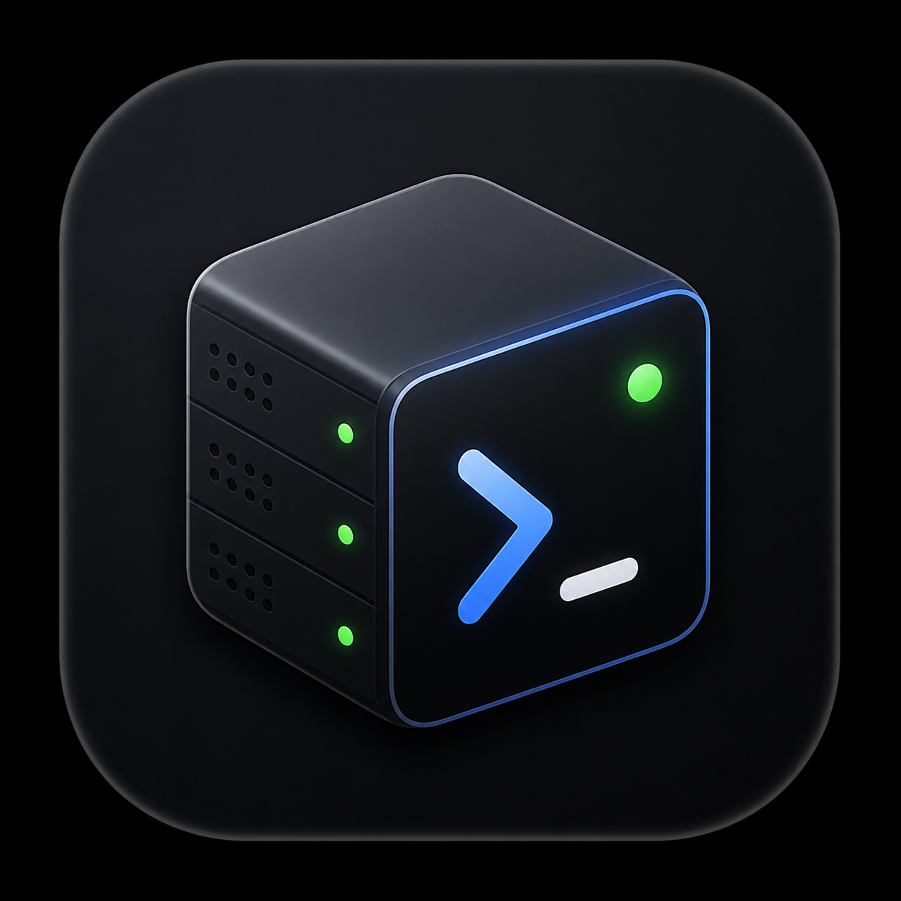
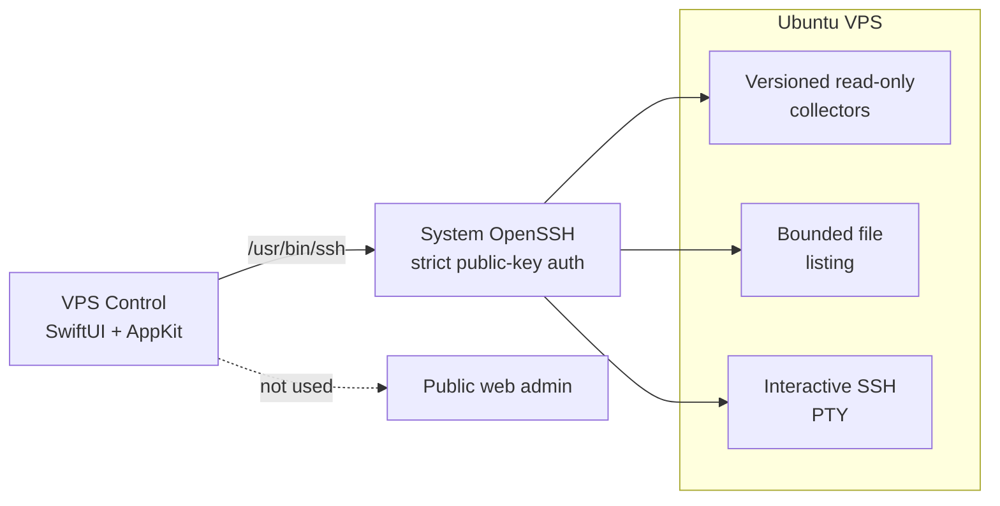

<p align="center">
  
</p>

<h1 align="center">VPS Control</h1>

<p align="center">
  Native macOS control center for securely monitoring and managing VPS servers over SSH.
</p>

<p align="center">
  
  
  
  
</p>

<p align="center">
  <strong>No web server. No public admin panel. No stored passwords.</strong>
</p>

---

VPS Control şəxsi serveri gündəlik SSH əmrləri yazmadan izləmək üçün hazırlanmış local-first SwiftUI tətbiqidir. Normal idarəetmə vizual interfeysdən, istisna hallar isə tətbiqin içindəki real SSH terminalından aparılır.

> [!IMPORTANT]
> İnkişaf verified local MVP mərhələsində dayandırılıb. Hazırkı build bir Ubuntu Server 24.04 LTS VPS ilə yoxlanılıb; bütün Ubuntu serverləri üçün universal compatibility hələ təmin edilmir.

## Nə verir?

| Sahə | Hazırkı imkanlar |
| --- | --- |
| **Overview** | CPU, RAM, disk, swap, load, uptime, network və OS məlumatları |
| **Security** | UFW, Fail2ban, SSH key, updates və reboot diaqnostikası |
| **Services** | systemd status, failed units və bounded listening-socket məlumatları |
| **Files** | SSH user-in görə bildiyi qovluqlar üçün read-only remote browser |
| **Docker** | Daemon, CLI version və socket trust statusu; management təhlükəsiz şəkildə locked qalır |
| **Terminal** | Altı taba qədər native SSH PTY, reconnect və açıq `sudo -i` rejimi |
| **Activity** | Tətbiqin yaratdığı lokal və redacted fəaliyyət qeydləri |
| **Settings** | Host, user, port, external key path, `known_hosts` və multiplexing |

## Arxitektura



- Native macOS tətbiqidir; lokal HTTP/WebSocket server işləmir.
- Metrics, diagnostics və file listing fixed, versioned collector-larla alınır.
- Terminal real PTY-dir və hər session normal SSH user kimi başlayır.
- Bir host üçün SSH multiplexing collector və terminal connection-larını paylaşa bilir.

## Təhlükəsizlik sərhədləri

- SSH VPS-in yeganə public management girişidir.
- Root SSH və password authentication istifadə edilmir.
- Private key tətbiqə import olunmur; yalnız mövcud faylın absolute path-i saxlanır.
- `StrictHostKeyChecking` söndürülmür və dəyişmiş host key avtomatik qəbul edilmir.
- Monitorinq default olaraq read-only işləyir.
- `sudo` yalnız istifadəçinin açdığı terminal daxilində görünən high-risk rejimlə aktivləşir.
- Docker socket root-equivalent hesab olunur; hazırda tətbiqə verilməyib.
- Portainer quraşdırılmayıb və public admin portu açılmır.
- Terminal keystroke-ları, sudo password-u və raw terminal history saxlanmır.

Tam security policy: [SECURITY.md](SECURITY.md)

## Quick start

### Tələblər

- macOS 14 və ya daha yeni
- Xcode/Swift 6.2 toolchain
- Sistem `/usr/bin/ssh` client-i
- Public-key SSH ilə əlçatan server
- Əvvəlcədən yoxlanmış `known_hosts` qeydi

### Clone və test

```sh
git clone https://github.com/bahramzada/vps-control.git
cd vps-control
swift test
swift run VPSControl
```

### Lokal `.app` yaratmaq

```sh
Scripts/package-app.sh release
```

Nəticələr:

```text
dist/VPS Control.app
dist/VPS Control.app.zip
```

Portable artifact strict-verified ZIP-dir. `dist/` source control-a daxil edilmir.

## İlk bağlantı

Tətbiqin **Ayarlar** bölməsində bunları daxil edin:

1. Server adı
2. IP və ya hostname
3. SSH user və port
4. Mövcud private key-in absolute path-i
5. Mövcud `known_hosts` faylının absolute path-i
6. İstəyə bağlı SSH multiplexing

Konfiqurasiya macOS `UserDefaults` daxilində lokal saxlanır. Private key məzmunu və sudo password-u persistence-a daxil edilmir.

## Testlər

```sh
swift test
```

Suite parser, timeout, cancellation, SSH policy, host-key failure, PTY lifecycle, terminal paste warning və remote file boundary-lərini yoxlayır. Real VPS testləri təhlükəsizlik səbəbilə opt-in-dir və yalnız `VPS_CONTROL_LIVE_TEST=1` ilə işləyir.

## Layihə quruluşu

```text
vps-control/
├── Assets/                  AppIcon assetləri
├── Packaging/               macOS bundle metadata
├── Scripts/                 release packaging
├── Sources/VPSControl/
│   ├── App/                 state və presentation
│   ├── Core/                typed SSH boundary və collectors
│   ├── DesignSystem/        native UI tokens
│   ├── Terminal/            SwiftTerm PTY workspace
│   └── UI/                  tətbiq ekranları
└── Tests/VPSControlTests/   unit və opt-in integration testləri
```

Lokal visual QA screenshot-ları private infrastructure metadata-sı daşıya bildiyi üçün `QA/` Git-dən kənarda saxlanır.

## Roadmap

İnkişaf bərpa ediləndə prioritetlər:

1. **Compatibility Check** — OS və capability preflight matrisi
2. **Server profiles** — multi-VPS əlavə etmə və sürətli keçid
3. **AZ / EN / TR** — String Catalog əsaslı tam localization
4. **AI Chat** — read-only-first, redacted context və approval-based actions

Docker/Portainer və privileged administration ayrıca security review tələb edir. Tam plan: [ROADMAP.md](ROADMAP.md)

## Documentation

- [Project facts and architecture](about_project.md)
- [Roadmap](ROADMAP.md)
- [Security policy](SECURITY.md)
- [Contributing guide](CONTRIBUTING.md)
- [Development progress](progress.md)
- [Troubleshooting notes](troubleshooting.md)

## License

Open-source license hələ seçilməyib. License əlavə edilənədək bütün hüquqlar müəllifdə saxlanılır.
